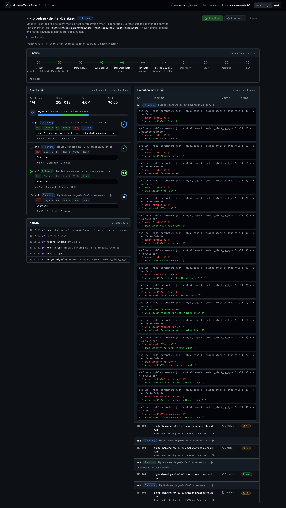

# Modello Tests Fixer

Fixes the Modello test configuration of an EverFi course when its generated Cypress tests fail.

It runs the course's tests, works out why each one failed, and changes only the test configuration files. It uses simple rules first and calls a Claude agent only when a failure needs judgement. Anything it can't prove with a passing test goes to a person. The result is a git branch with the fixes committed, ready for CI and for you to open a pull request.



*The control room during a run on `digital-banking`: pipeline stages at the top, one row per course module on the left, every test and every change on the right.*

---

## Contents

1. [The problem](#the-problem)
2. [Quick start](#quick-start)
3. [How it works](#how-it-works)
4. [What it will and won't change](#what-it-will-and-wont-change)
5. [The control room](#the-control-room)
6. [Commands](#commands)
7. [Project structure](#project-structure)
8. [Development](#development)
9. [Status and limitations](#status-and-limitations)

---

## The problem

EverFi courses generate their end-to-end tests with **Modello**, run through **ECC** (the EverFi Content Compiler). Modello builds one Cypress test per course module, using the course content and three configuration files in the course's `test/ui/` folder:

| File | What it holds |
|---|---|
| `model-parameters.json` | Selectors and settings for blocks on each page, for example which button opens a modal |
| `model-map.json` | Blocks replaced by custom test code, or skipped |
| `model-edges.json` | How pages and blocks connect for navigation |

When the course changes, for example a button gets a new id, a test can fail even though the course works. The fix is usually one value in one of these files. Finding that value, rebuilding every test and re-running takes minutes per attempt, and it's easy to get wrong. This tool runs that loop for you.

## Quick start

**You need:**
- Node 20+ and a Claude login (your Claude Code login, or `ANTHROPIC_API_KEY`)
- `ecc`, `modello`, `yq`, `yarn` and `git` installed
- a clean git checkout of the course
  - Only a local `test/ui/config/cypress.config.js` edit may differ, for example Applitools switched off.

**Run it:**

```bash
npm install
npm run ui:build            # once, builds the control room
npm run fix-course -- --project /Users/jay/everfi/git/courses/digital-banking --serve
```

Open http://localhost:4317 to watch. When it finishes:
- it asks whether to push the branch it created
- CI tests the pushed branch
- you open the pull request

**Cost:** rules and recipes cost nothing. Each Claude agent is capped at $5 by default (`--max-budget-usd`), and you can cap the whole run with `--max-total-usd`.

## How it works

```
 prepare            test               fix (cheapest first)              finish
┌──────────┐   ┌──────────────┐   ┌──────────────────────────────┐   ┌──────────────────┐
│ checks   │   │ run every    │   │ environment? → to a person   │   │ re-test fixes    │
│ branch   │──▶│ module's     │──▶│ flaky?       → note it       │──▶│ write report     │
│ install  │   │ test, in     │   │ known fix?   → apply, test   │   │ commit config    │
│ build    │   │ parallel     │   │ otherwise    → Claude agent  │   │ push (you agree) │
│ generate │   └──────────────┘   │               one at a time  │   └──────────────────┘
└──────────┘                      └──────────────────────────────┘
```

**1. Prepare.**
- **Checks:** the required tools are installed, Cypress can start, and the course checkout is clean.
- **Branch:** creates a branch named `test/modello-fixes-<date-time>` from `origin/develop`.
- **Install, build, generate:** installs the course's dependencies, builds the course, and generates the tests, the same way CI does.

**2. Test.** Runs every module's test in the course folder, several at once, and collects the results. Modules that pass are done.

**3. Fix**, trying the cheapest option first for each failing module:

| Step | When it applies | Uses AI? |
|---|---|---|
| Environment check | Cypress couldn't start, the network or login failed, or no report was produced. Not a config problem, so it goes to a person with the error line. | No |
| Flaky check | The test passes when simply run again. Marked flaky; nothing is changed. | No |
| Known fix | There's exactly one obvious answer:<br>• a fix that worked before<br>• a field name wrapped in translation markup<br>• an id that was renamed, with exactly one similar id in the course | No |
| Claude agent | Anything else. One agent at a time gets a short brief of everything already found, makes a change, rebuilds and re-runs the test. | Yes |

A change is kept only if the rebuilt test passes; otherwise it's undone. Fixes that agents prove are remembered, so the same failure is fixed without AI next time.

**4. Finish.**
- **Re-test:** runs all fixed modules again together.
- **Report:** writes a report to `runs/<run-id>/report.md`.
- **Commit:** commits only the configuration files.
- **Push:** asks before pushing. CI runs on any pushed `test/**` branch.

If nothing was fixed, or you stop the run with Ctrl-C before a commit, it returns you to your original branch and deletes the empty one.

## What it will and won't change

The tool can only:
- change existing values in `model-parameters.json`, `model-map.json` and `model-edges.json`
- commit those files on its own `test/modello-fixes-*` branch
- push that branch after you say yes

It never:
- edits course content or code (the build regenerates compiled output and tests, which git ignores)
- commits to or pushes `develop`, `master` or `main`, or force-pushes
- opens or merges a pull request
- keeps a change that hasn't passed a rebuilt test

These limits are enforced in code, not just in the agent's instructions:
- **File allowlist:** a write guard allows only the three files and single values, never whole sections.
- **Limited agent tools:** the agent has no shell and no file-editing tools, and can read only inside the course.
- **Commands:** the agent never writes command lines, and git commands are fixed in code.

## The control room

A local web page (`--serve`, http://localhost:4317) that shows a run as it happens:

- **Pipeline:** each stage with its status and a short detail.
- **Agents:** one row per module, showing:
  - status and steps
  - the latest action
  - time, tokens, cost and turns
  - "no AI" when a rule or known fix handled it

  Click a row to filter the matrix.
- **Execution matrix:** every test with its result, and each change shown as a diff.
- **Theme:** GitHub-style, light or dark.

It listens only on your own machine and refuses requests from other sites. A **Run demo** button plays a scripted run with no Cypress and no cost.

## Commands

| Command | What it does |
|---|---|
| `npm run fix-course -- --project <course> [--serve]` | The full pipeline above. Main entry point. |
| `npm run orchestrate -- --serve` | Control room only; use **Run demo** to see it work. |
| `npm run orchestrate -- --project <course> [--write]` | Test and fix without the git steps. |
| `npm run dev -- --project <course> --spec <file> [--write]` | One agent on one test file (the original tool). Proposes only, unless `--write`. |
| `npm run eval -- --yes` | Quality check with real agents on a small test course (about $1). |

Useful `fix-course` options:

| Option | Default | Meaning |
|---|---|---|
| `--concurrency <n>` | 2 | Tests run at the same time |
| `--push` | ask | Push without asking |
| `--max-budget-usd <n>` | 5 | Spend cap per agent |
| `--max-total-usd <n>` | none | Spend cap for the whole run |
| `--model <id>` | `claude-sonnet-4-5` | Claude model for agents |
| `--skip-course-build`, `--skip-install` | off | Reuse what's already built or installed |
| `--skip-flaky-check`, `--skip-recipes`, `--skip-cypress-verify` | off | Turn off individual checks |

Full list: `npm run fix-course -- --help`.

Exit codes: `0` everything passed or was fixed, `2` some modules need a person, `1` a stage failed.

## Project structure

```
src/
  fix-course.ts        command: the full pipeline
  pipeline/            pipeline stages, git steps, report
  orchestrator/        test-then-fix flow, events for the UI, scheduler, demo/replay
  triage.ts            environment rules (no AI)
  recipes.ts           known fixes and the fix ledger (no AI)
  locate.ts            finds the failing selector, test block and config entry
  casefile.ts          the brief handed to an agent
  agent.ts, prompt.ts  the Claude agent: loop, permissions, instructions
  tools/               the only tools the agent can use
  guard.ts             write guard for the three config files
  session.ts           runs tests, applies changes, rebuilds
  server/              local server for the control room
ui/                    control room (React)
test/                  unit tests; test/eval/ is the quality check
docs/                  architecture, progress log, lessons learned
```

More detail: [docs/architecture.md](docs/architecture.md).

## Development

```bash
npm test               # unit tests (fake Cypress, ECC and git)
npm run typecheck      # source and UI
npm run ui:build       # rebuild the control room
npm run ui:dev         # UI with live reload on :5173
```

Unit tests can't catch problems that only appear against a real course; several of the bugs listed in [docs/lessons-learned.md](docs/lessons-learned.md) were found that way. Check changes to building or running tests on a real checkout as well.

This repo is built with Claude Code. `CLAUDE.md` holds the working rules, and `.claude/` holds the shared skills (`ecc-course-dev`, `modello-tests`, `course-pr`, `code-review`, `wrap-up`) and subagents (`reviewer`, `researcher`).

## Status and limitations

**Tested so far:**
- Unit tests pass, including a rule-based quality check.
- Each stage has been run against the real `digital-banking` checkout.
- A full run with real agents hasn't completed end to end yet.
- The paid quality check (`npm run eval -- --yes`) hasn't been run.

Progress and next steps: [docs/progress.md](docs/progress.md).

**Known limitations:**
- **Locating failures:** Cypress doesn't report which page failed, so the failing selector in the error message is used to find it.
- **Speed:** a real test run takes 1–6 minutes per module, and each rebuild regenerates every test.
- **Content drift:** tests are generated from compiled course content, which can be older than the deployed course.
- **Coverage:** selector fixes are the most proven case; navigation (`model-edges.json`) fixes are less exercised.
